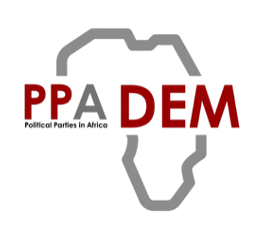

  

# PPADEM PowerPoint and Word templates

Branded templates for anyone who works in Microsoft PowerPoint or Word rather than
Quarto. They use the same colours and logo as the PPADEM website.

| File | What it is |
| --- | --- |
| [`PPADEM-presentation.potx`](PPADEM-presentation.potx) | **PowerPoint template.** Start every new deck from this. |
| [`PPADEM-presentation-example.pptx`](PPADEM-presentation-example.pptx) | An example deck showing every layout, a chart, a table and stat tiles. |
| [`PPADEM-document.dotx`](PPADEM-document.dotx) | **Word template** with a cover page, contents page, headings and two callout boxes. |
| [`PPADEM-document-example.docx`](PPADEM-document-example.docx) | An example document showing every style and how to apply it. |

To download a file, click its name above, then click the **Download raw file** button
(the arrow icon at the top-right of the page).

## PowerPoint

**Start a new presentation:** double-click `PPADEM-presentation.potx`. PowerPoint opens a
new, untitled presentation with a title slide, so the template itself is never changed.

**Add slides:** *Home → New Slide* and pick a layout. The layouts are:

| Layout | Use it for |
| --- | --- |
| Title Slide | The first slide: title, subtitle, presenter and date |
| Title and Content | Most slides: a title and bullet points, a table, chart or picture |
| Section Header | A red divider between parts of a talk |
| Two Content / Comparison | Two columns side by side (Comparison adds a heading over each) |
| Title Only | A title and free space for your own shapes, charts or stat tiles |
| Content with Caption | A large chart, table or picture with a short key message beside it |
| Blank | Logo and footer only |
| Closing | "Thank you", contact details and the EU funding logo. End every deck with it |

**Change a slide's layout:** *Home → Layout*.

**Make it appear under File → New (optional):** save the `.potx` into your *Custom Office
Templates* folder (in *Documents* on Windows; on a Mac, open the `.potx` in PowerPoint and
use *File → Save as Template*). It then appears under *File → New → Personal* (Windows) or
*File → New from Template* (Mac).

**Applying the look to an existing deck:** open the deck, then *Design → Themes → Browse for
Themes* (Windows) or *Design → ▾ → Browse Themes* (Mac) and choose the `.potx`. Check each
slide afterwards: slides with hand-placed text may need tidying.

## Word

**Start a new document:** double-click `PPADEM-document.dotx`. Word opens a new, untitled
document with a cover page and contents page. Replace the text in [square brackets].
The EU funding logo is at the end of the document: keep it as the last thing in the document.

**Format with styles, not by hand.** Click in a paragraph and choose a style from *Home →
Styles*. The gallery holds only the PPADEM styles:

| Style | Use it for |
| --- | --- |
| Title, Subtitle | The cover page |
| Heading 1, 2, 3, 4 | Section headings. Heading 1 has a red rule, Heading 3 is teal and Heading 4 italic. Headings 1–3 build the table of contents |
| Body Text | Normal paragraphs |
| PPADEM Note | A teal box for background information, tips or a short summary |
| PPADEM Warning | A gold box for caveats |
| Caption | Captions for tables and figures |

**Tables:** insert a table, then choose the *Table* style from *Table Design → Table Styles*
(under *Custom*, at the top of the list).

**Table of contents:** right-click it and choose *Update Field* after adding headings.

## Colours

When colouring text, shapes or charts in either program, choose from the **Theme Colours**
row at the top of the colour menu. It holds the PPADEM palette:

| Colour | Hex | Use |
| --- | --- | --- |
| Red | `#990000` | Main brand colour, headings, accents |
| Teal | `#298c8c` | Secondary colour, subtitles |
| Gold | `#f1a226` | Highlights |
| Grey | `#b8b8b8` | Muted elements |

Charts inserted in PowerPoint or Word use these colours automatically.

The templates use **Arial**, which is installed on every computer, so documents look the
same when you share them.

## Updates

The templates are generated from the same brand files as the Quarto formats, so they stay in
step. If the brand changes, download the latest version from this folder.

---

*Maintainers:* these files are built by `tools/build-powerpoint.py` and
`tools/build-reference-docx.py` (run `python3 tools/sync-brand.py --office`). Don't edit them by
hand: changes are overwritten on the next build. See the main [README](../README.md).
