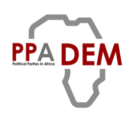

<!--
A starter page showing every part of the PPADEM website theme. Keep the parts
you need and delete the rest. The README explains each component.
-->

::: {.ppadem-hero}
::: {.row .align-items-center}
::: {.col-lg-8}
[PPADEM Data Science]{.ppadem-pill}

# Data science for research on parties and democracy {.ppadem-hero-title .unlisted}

::: {.ppadem-hero-subtitle}
Training courses, practical guidance and open tools for the PPADEM research team and partners.
:::
:::

::: {.col-lg-4 .text-center .mt-3 .mt-lg-0}
{fig-alt="PPADEM logo" style="max-height: 120px; width: auto;"}
:::
:::
:::

::: {.ppadem-highlights-strip}
::: {.ppadem-highlight-tag}
**6** training courses
:::
::: {.ppadem-highlight-tag .teal}
**12** how-to guides
:::
::: {.ppadem-highlight-tag .gold}
**4** open-source tools
:::
:::

## 🎯 What you'll find here

This site brings together everything the data science team offers. Use the cards to jump to
a section, or the contents on the right to move around this page.

::: {.ppadem-card-grid}
::: {.ppadem-card}
### Training {.unlisted}

Short courses on R, reproducible workflows, text analysis and data visualisation.

[See courses &rarr;](#courses){.card-link}
:::

::: {.ppadem-card .teal}
### Guidance {.unlisted}

Advice on data management, ethics, storage and sharing research outputs.

[Read the guidance &rarr;](#advice){.card-link}
:::

::: {.ppadem-card .gold}
### Tools {.unlisted}

Packages and templates built by the team, free for anyone to use.

[Browse tools &rarr;](#open-tools){.card-link}
:::
:::

## 📚 Training {#courses}

Courses run each term, online and in person. Each one has slides, exercises and recordings.

| Course | Level | Length | Next run |
|:-------|:------|-------:|:---------|
| Introduction to R | Beginner | 2 days | February |
| Reproducible research with Quarto | Beginner | 1 day | March |
| Text analysis of party documents | Intermediate | 2 days | April |
| Data visualisation | Intermediate | 1 day | May |

: Upcoming courses {#tbl-courses}

::: {.callout-tip}
## Book a place
Email the data science team with the course name and your preferred dates.
:::

## 🧭 Guidance {#advice}

### Managing research data

::: {.ppadem-key-findings}
[Five rules for every project]{.ppadem-label}

1. Keep raw data read-only, and never edit it by hand.
2. Store everything on the shared project drive, not on your laptop.
3. Write a short README for every dataset.
4. Use version control for code.
5. Check consent and licences before sharing anything.
:::

::: {.callout-important}
Personal data from interviews must stay on approved university storage.
:::

### Working with the team

::: {.ppadem-quote}
Good data practice is not extra work: it is what makes the research possible to check and reuse.
[— PPADEM data science team]{.attribution}
:::

> Plain Markdown quotes get a quieter version of the same style.

## 🛠️ Tools {#open-tools}

Most tools are R packages. Install them from GitHub:

::: {.panel-tabset}
### R

```r
# install.packages("remotes")
remotes::install_github("PPADEM/scopingreview")
```

### Python

```python
# Python versions are on the way
```
:::

::: {.callout-warning}
Some tools need an API key. Keep keys in `.Renviron`, and never commit them to GitHub.
:::

::: {.callout-note}
Have an idea for a tool or a course? Open an issue on [GitHub](https://github.com/PPADEM).
:::
